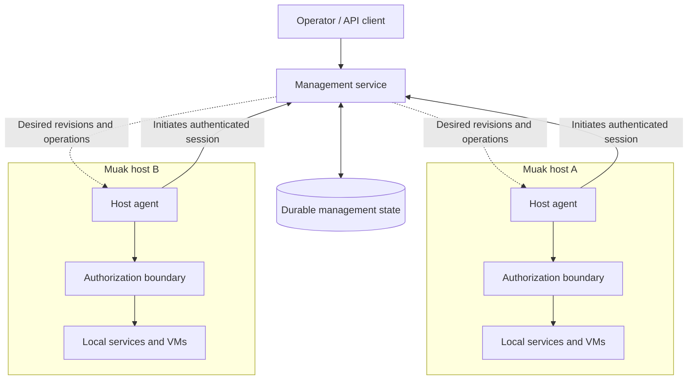
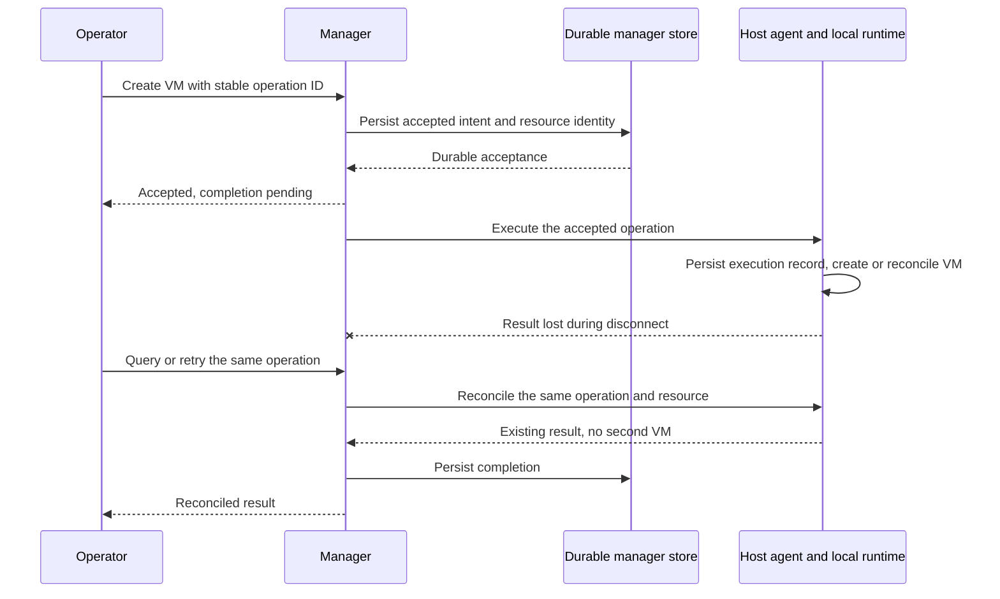
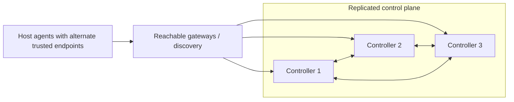

# ADR 0001: Optional multi-host coordination

**Status:** Proposed

**Date:** 2026-11-15

**Decision scope:** Optional fleet management and its path to management HA.
This ADR records a proposed direction; acceptance by maintainers is pending.

**Repository baseline:** [`41543f45`](https://github.com/muak-os/muak/commit/41543f45fb88a311285be4312a1c9b63ab7a5e49),
reviewed on 2026-11-15.

## Proposed decision

Introduce optional fleet management through authenticated, host-initiated
connections to one logical management service. Start with a single durable
manager, stable machine identities and inventory, then add reliable VM operations
on explicitly selected hosts. Existing workloads continue locally when management
is unavailable.

Support automatic management failover as a later deployment option using three
voting controllers. Treat automatic VM recovery on another host as a separate
capability requiring storage availability and enforcement of exclusive ownership.
Neither leader election nor a working tunnel supplies those guarantees.

This sequence is a recommendation, not an accepted roadmap. If automatic manager
failover is required in the first release, qualify replicated authority before
enabling remote mutations. Controller placement, transport and storage remain
open decisions.

## Context and use cases

This proposal addresses the [multi-node orchestrator item in `TODO.md`](../../TODO.md),
which mentions VM cluster management, a possible WireGuard tunnel and service
accounts based on existing authentication. The item is an opportunity statement;
it does not prescribe this architecture or establish maintainer acceptance. This
draft implements only part of the inventory foundation, not the full TODO item.

Muak already provides declarative configuration and a local gRPC/mTLS API. A
management service would give operators a common view and a reliable way to act
on several hosts, including hosts behind NAT or intermittent site connections.
The initial value should not depend on having three physical machines.

| Scenario | Operator outcome | Scope |
| --- | --- | --- |
| Small installation | Register one or two hosts; list their VMs; manage a VM on a chosen host. | Initial target; manager outage pauses central management. |
| Remote or branch hosts | Hosts reconnect outward after a WAN outage; inventory shows when observations became stale. | Initial target; local workloads retain their last applied configuration. |
| Configuration and maintenance | Reconcile an authorized revision; update or reboot hosts in batches under an explicit availability policy. | Follow-up after reliable operations. |
| Management requiring automatic failover | Continue accepting decisions after losing one controller. | Optional three-voter control plane. |
| Autonomous sites | A site makes local decisions while central fleet reporting is interrupted. | Later composition of site authority and fleet supervision. |
| Recovery after a workload-host failure | Restart a VM elsewhere with usable storage and no active old owner. | Separate workload-HA project. |

Disk replication, live migration, automatic placement and a general-purpose
overlay network are outside the first milestone. Their storage, networking and
hypervisor requirements need separate designs.

## Architecture

The **manager** owns desired state and accepted operations. A **host agent** reports
observations and executes authorized operations through Muak's service boundaries.
These are logical roles; their process names and packaging are undecided.



*Solid agent-to-manager arrows show session initiation. Established sessions carry
reports and commands in both directions; they do not require inbound host access.*

A bidirectional gRPC stream with mTLS is the first transport candidate because
Muak already uses these primitives. Kubernetes Konnectivity demonstrates the
host-initiated management-tunnel pattern [2]. SideroLink is the reference for
enrollment and optional IP connectivity: its Talos 1.8 documentation describes
WireGuard links to a management server, ephemeral tunnel keys and no direct
node-to-node communication [1].

Use WireGuard if generic IP access to existing management protocols is needed.
That choice adds address allocation, routing, key lifecycle, UDP restrictions and
gateway failover. A management tunnel does not imply a disk-replication network.

## Identity, authorization and state ownership

Assign a durable node identity and an explicit management-domain identity.
Certificate rotation, changing IP addresses and tunnel reconnects must preserve
node identity. Reinstallation and factory reset need explicit replacement or
adoption semantics. An empty replacement manager must not silently claim hosts.

Enrollment requires an authenticated approval path. Give agents narrowly scoped
credentials; preserve per-method authorization and operator audit context when
dispatching operations. Private keys remain subject to a separate storage policy.
Revocation and credential rotation must account for already established sessions
and disconnected hosts.

| State | Authority and persistence |
| --- | --- |
| Approved nodes, roles and revocations | Durable management records. |
| Desired configuration, VM identity and host assignment | One designated authority per managed resource; revisioned and durable. |
| Accepted operations and recoverable results | Durable manager records plus host execution records; explicit retention policy. |
| Inventory, health and applied revisions | Host-reported observations; reconstructible and potentially stale. |
| VM disks, images, metrics and bulk logs | Separate storage and bounded transfer paths; outside the decision journal. |

This is asynchronous reporting around an authoritative desired state, rather than
unrestricted bidirectional copying of configuration files. Reconciliation follows
the desired/observed-state control-loop pattern [2]. Define whether local edits to
a centrally managed resource are rejected, explicitly overridden, or submitted as
a change; silent last-writer-wins behavior would obscure authority.

Reports include a manager-accepted session incarnation and a sequence or revision.
Reject obsolete sessions and out-of-order reports. After reconnect, reconcile a
fresh snapshot with desired revisions and operation results. Bound queues and
history, use retry backoff with jitter, and expose observation timestamps.
Silence indicates lost contact, not proof that the host or its VMs have stopped.

## Reliable operations before automatic retries

An interrupted response leaves an unknown outcome. The caller must be able to
retrieve or retry the same operation without requesting a new VM. Explicit caller
request identifiers and durable deduplication are established API techniques [3].

Proposed operation semantics:

- Bind a stable operation ID to its caller/domain, target resource and intent.
  Reusing the ID with different intent is an error.
- Persist acceptance before dispatch; distinguish acceptance from completion.
- Preserve an execution record on the host and a stable resource identity.
  Recover partial disk and hypervisor effects by inspecting and reconciling them.
- Return the existing outcome on retries. A timeout alone is not a failed action.
- Define retention and retry horizons. Expiring a deduplication record must not
  silently turn an old retry into a second resource creation.



*Conceptual flow, not an implemented API or a complete crash-recovery protocol.*

Writing a request ID immediately before or after a disk action does not make
those effects atomic. The implementation must specify recovery at each boundary,
including a crash after resource creation but before result persistence. Do not
claim exactly-once execution for arbitrary host actions.

## Election and management failover

With one designated manager, no election is necessary. Its failure pauses central
operations until restart or explicit recovery. Local VM execution is independent.

For automatic management failover, use a consensus implementation that provides
leader election and a replicated decision log together [4]. Persist protocol state
and use its safe membership-change procedure. Registering a worker does not make
it a voter, and an unreachable voter must not be automatically removed.



*Illustrative reachability, not a requirement for a particular Raft transport.
Gateways and controllers are logical roles; they may be colocated. Each voting
controller keeps a durable replica.*

The elected leader orders decisions; a gateway provides connectivity. Voters must
remain mutually reachable independently of the current leader, and agents need a
way to reach its successor. A star whose only hub is the failed leader cannot be
the sole path for failover.

| Deployment | Management availability |
| --- | --- |
| One controller, any number of workers | No automatic failover; recover durable state explicitly. |
| Two voting controllers | Both are required for progress; no tolerance of one unavailable voter. |
| Three voting controllers | A reachable majority of two can continue after an election. |
| Two VM hosts plus a controller-only member | Can provide three votes if the third member satisfies the backend's durable-replica contract. |

These majority requirements and WAN latency tradeoffs are documented by etcd [5].
Choose independent failure domains, not merely three processes. Proxmox's QDevice
illustrates Corosync arbitration for small clusters; it is not a stateless replica
that can be substituted into an arbitrary Raft implementation [6].

The assumed consensus fault model includes crashes, restarts and delayed or lost
messages. It does not protect against authenticated controllers deliberately
violating the protocol [4].

## Partitions, workload ownership and recovery

| Event | Required behavior to validate |
| --- | --- |
| Host disconnects | Mark observations stale; retain local VMs; reconcile on return. |
| Single manager stops | Pause central operations; restart or restore the manager. |
| HA leader fails | A reachable majority elects a successor; reconnect and reconcile pending operations. |
| Controllers split 2–1 | Only the majority commits; prevent obsolete authority from dispatching conflicting effects. |
| Majority is lost | Stop new authoritative writes; do not invent replacement membership. |
| Command response is lost | Keep outcome unknown until reconciled; retry the same identity. |
| Backup is restored | Reconcile newer host-side effects before resuming mutations. |

For initial host-bound VM management, a management partition neither stops a VM
nor causes another host to recreate it. In a future HA control plane, a new leader
must not coexist with stale commands accepted from an isolated old leader.
Specify enforcement before enabling HA mutations: a term stored on an isolated
agent does not reveal that a newer leader exists elsewhere.

Automatic VM recovery has a stronger requirement: exclude the previous owner from
the protected execution or storage resource before starting a replacement. This
may require power fencing, storage-access revocation or validated self-fencing.
Proxmox documents quorum and watchdog-based fencing for HA recovery [6]. Kleppmann
explains why leases and generation tokens need enforcement at the protected
resource [7]. A missed heartbeat is insufficient.

Consequently, unconditional workload continuation on every isolated host cannot
also be promised for every future HA policy. Storage freshness, device access and
VM networking remain additional recovery prerequisites.

Restoring a backup can rewind management history while hosts retain newer effects.
etcd documents analogous revision and observer-cache issues during restoration
[5]. Muak also needs an authority-handover procedure: exclude the previous manager,
supersede sessions, collect host execution records, and reconcile before dispatch.
Absence from a restored backup is not evidence that a command never ran.

## Implications for the current Muak code

The following are source observations at the baseline above, not tested failures.

| Existing component | Design implication |
| --- | --- |
| [`apid` authorization](../../services/apid/src/handler.rs) and [`auth.proto`](../../api/auth.proto) | Reuse authentication and enrollment primitives while defining machine roles. Direct access to local sockets must preserve equivalent policy checks. |
| [`CreateVmRequest`](../../api/vm.proto) lacks an operation ID; [`handle_create`](../../services/workloadd/src/actor/state.rs) generates a new UUID per call | A replay can request another VM. Reliable remote creation needs an explicit operation/resource identity contract. |
| [`save_vm`](../../services/workloadd/src/persistence/state.rs) writes JSON with `fs::write` | This is not a crash-consistent operation journal spanning request identity and external effects. Define local recovery as well as manager durability. |
| [`workloadd` state recovery](../../services/workloadd/src/actor/state.rs) queues local automatic restarts | Future movable ownership must constrain restart on a returning old owner. Workload data is currently local. |
| [`STATE_SIZE`](../../libs/disk/src/sizes.rs) is 1 GiB | An on-host controller database requires a storage budget, bounded logs, compaction and disk-full behavior. |
| [`granola` watchdog notification](../../init/granola/src/runtime/notify.rs) is a supervisor keepalive | It does not establish a hardware watchdog or independently enforced node fencing. |

Preserve Muak's minimal standalone deployment. Management packaging should be
optional; a worker should not require a controller database merely to run VMs.

## Relationship to wizard and provisioning

Wizard builds boot artifacts; runtime services own enrollment, connections and
observed inventory. There is currently no dependency from wizard, a daemon or
`muakctl` to the `coordination` library, and no fleet configuration in the system
schema. The existing strict system-config decoder rejects unsupported fields.

The intended integration has three boundaries:

1. **Image composition:** a wizard profile selects the optional agent package or
   extension once packaging is designed. Profiles currently select kernel,
   overlay and extension inputs; see [the profile model](../../toolchain/wizard/src/domain/profile.rs).
   Existing profiles must retain standalone behavior.
2. **Provisioning:** an optional, versioned runtime configuration declares the
   trusted management endpoint and enrollment policy. Installation and update use
   [provisiond](../../services/provisiond/src/install/mod.rs) and
   [system configuration](../../libs/config/src/system/mod.rs). Exact fields,
   storage paths and credential delivery are not selected by this ADR.
3. **Runtime:** an agent creates or loads a per-node identity in persistent STATE,
   authenticates, reconnects and reports local VM observations. The manager stores
   enrollment decisions separately from rebuildable observations.

The same image may boot several machines: a node UUID or private key must not be
shared through that image or its embedded profile metadata. Generate identity per
installation, preserve it across ordinary updates, and define reset/replacement
semantics. Kernel-command-line customization does not currently implement fleet
bootstrap; credentials should not be carried through that command line.

Artifact tests must verify optional package selection and unchanged standalone
profiles. Install/update tests must verify preservation of configuration and
identity. A booted integration test must establish that the packaged agent really
starts and enrolls; artifact inspection alone cannot establish that behavior.

## Alternatives considered

| Option | Fit | Work still required |
| --- | --- | --- |
| Single manager with transactional local storage | Recommended initial deployment. | Crash recovery, backup/restore, operation reconciliation and later schema migration. |
| External etcd | Baseline for a separately operated HA management service. | Credentials, operations, backup/restore and command-authority integration. |
| Embedded OpenRaft | Candidate for an integrated Rust control plane. | Durable log and state machine, transport, snapshots, membership and recovery [8]. |
| TiKV `raft-rs` | Lower-level consensus alternative. | Application event loop, persistence and transport integration [8]. |

No backend or library version is selected. Compare real deployment complexity,
storage durability, resource use, musl support and upgrade behavior before choosing.
Neither etcd nor a Raft library solves host-side operation recovery or VM fencing.

## Consequences

- A single manager is useful for small installations and remote hosts, with an
  explicit central-management outage during manager failure.
- Local VM operation remains independent of management connectivity in the initial
  scope. Automatic cross-host recovery requires a separate storage/fencing design.
- Stable identities and recoverable operations must precede transparent retries.
  This adds durable-state and reconciliation work before broad remote control.
- Transport-independent inventory logic can be tested without an OS image, while
  certificate handling, persistence and real connectivity need integration tests.
- Starting with one manager reduces initial deployment requirements but does not
  make later HA integration or migration free. A three-voter deployment adds
  storage, membership, discovery and recovery obligations.

## Delivery stages and acceptance evidence

| Stage | Deliverable | Evidence required before expanding scope |
| --- | --- | --- |
| 1. Identity and inventory | One durable manager; three test agents; scoped enrollment; visible staleness. | Reconnect and reboot preserve identity; foreign/revoked peers and obsolete sessions are rejected; restart and old-backup restore reconcile observations. |
| 2. Reliable VM creation | Create on an explicitly chosen host with recoverable operation identity. | Inject crashes around persistence, dispatch, creation and response; recover one VM and one result; reject reused IDs with different intent. |
| 3. Declarative management | Desired/applied revisions and maintenance policy. | Reordering, reconnect and local-edit conflicts converge under documented authority; queues and history remain bounded. |
| 4. Optional management HA | Persistent three-voter backend and alternate management paths. | Exercise 2–1 partitions, suspended leaders, obsolete-leader return, all-controller restart, disk-full, snapshots and member replacement. |
| 5. Optional workload HA | Storage and enforceable exclusive ownership. | Demonstrate fencing before replacement, including stale-owner reboot and partitioned storage access. |

Advance stage 4 before stage 2 if automatic manager failover is an initial
requirement. For independent sites, keep authority within appropriate local
failure domains and report asynchronously to the fleet manager unless a WAN
quorum is an explicit, measured requirement.

Protocol simulations are only one layer of evidence. Muak boot, real network
partitions, NAT/tunnel behavior, hypervisor execution and storage fencing need
their own integration checks. Availability targets must name the operation,
tolerated failures and outage bound; none has been measured by this proposal.

## Draft implementation status

The `coordination` workspace library is an initial, in-memory implementation of
inventory semantics. It binds approved node UUIDs to credential fingerprints,
issues manager-scoped session generations, rejects obsolete sessions and reordered
reports, and retains bounded full snapshots with manager-local freshness. Rotation
and revocation invalidate active sessions. A runnable example simulates three
hosts; regression tests cover reconnect, rejection and resource limits.

The library trusts an authenticated identity supplied by its caller. It does not
verify certificates or add an API endpoint. Its administrative methods must be
protected by the future adapter. Enrollment storage, transport, process packaging,
restart recovery and VM mutations are not implemented. A new registry has a fresh
random session scope; restoring approvals must never restore old sessions.

Run the current prototype with:

```sh
cargo run --locked -p coordination --example inventory
just test coordination
just lint coordination
```

This is partial progress on stage 1, not evidence that the complete stage or any
HA guarantee has been delivered.

## Operator workflow and first functional merge gate

**Available now:** developers can read this ADR and run the in-process example
above. Its UUIDs and credential fingerprints are synthetic. It opens no network
connection, discovers no installed hosts, and does not read live VM inventory.
There is no fleet command in `muakctl`, fleet daemon, or web interface in this MR.
The existing CLI's single-host operations remain the way to manage real hosts.

**Proposed first operator workflow:**

1. Deploy a management service and establish its persistent domain and trust.
2. Opt a host into management using supported runtime configuration, during
   provisioning or an explicitly supported update path.
3. Review and approve the host's enrollment using narrowly scoped authorization.
4. Consult a CLI inventory showing node identity, hostname, VMs, last observation
   and whether the observation is stale. A lost connection must be distinguishable
   from evidence that a VM stopped.
5. Reconnect or reboot a host without duplicate registration; rotate or revoke its
   credential while retaining an auditable administrative history.

This workflow is a product contract for the next increment, not available command
syntax. CLI names and configuration fields must be designed with their adapters.
VM creation, election and cross-host recovery are subsequent capabilities.

The current MR is suitable for architecture and prototype feedback. To present it
as an operator-usable inventory feature, finish one vertical slice: durable
enrollment, authenticated RPCs, an outbound agent reading actual `workloadd`
inventory, CLI consultation, optional packaging and user documentation. If only
the library is proposed for merge, agree that narrower scope and its intended
consumer with maintainers; passing CI does not demonstrate operator usefulness.

| Acceptance claim | Test and observable result | Current evidence |
| --- | --- | --- |
| Registry ordering and isolation | Reconnect, delayed report/close callback, rotation, revocation and rejected snapshots preserve the correct current observation. | Sixteen in-process tests cover this layer. No certificate handshake is performed. |
| Durable enrollment | Terminate and restart the manager and agent; preserve identities and revocations, reject obsolete sessions, and fail closed on corrupt state. | Not implemented. Reconstructing a registry in a test is not a disk-recovery test. |
| Authenticated connectivity | Use real test certificates over the selected RPC transport; reject foreign, revoked and mismatched identities; enforce administrative permissions. | Not implemented. Caller-supplied fingerprints are not proof of authentication. |
| Real inventory and CLI | Run one manager and at least two agents; discover actual workload state through the selected service boundary; sever a connection, observe stale CLI output, reconnect and recover without duplicate nodes. Verify context/endpoint selection. | Not implemented. The example synthesizes observations in one process. |
| Provisioning and lifecycle | Build one reusable image; boot two installations with distinct identities; update one without changing its identity or opting an unmanaged host into fleet management. | Not implemented. Requires artifact checks and booted integration evidence. |

Network tests can initially run as local processes with test PKI, deterministic
disconnects and temporary storage. That proves the adapters within that harness.
OS packaging, granola supervision, SELinux and installed-state behavior still
require Muak integration tests; no booted result is claimed by this draft.

## Open questions for maintainers

1. Is the first target a small installation, remote fleet, or autonomous HA site?
   Is automatic management failover required immediately?
2. Where should the manager run: externally, on designated Muak hosts, or both?
   What scale and resource budgets should the first implementation support?
3. Is a narrow authenticated management stream sufficient, or is generic IP
   connectivity a product requirement?
4. Which resources become centrally managed, and how are local edits handled?
5. What identity, backup-retention and authority-replacement policies are required?
6. Is workload HA a planned separate project, and with which storage/fencing model?

## References

The mechanisms below are established by their authors and maintainers. Their
selection and application to Muak in this proposal are engineering recommendations.

1. **Sidero Labs:** [SideroLink, Talos 1.8](https://docs.siderolabs.com/talos/v1.8/networking/siderolink).
   Versioned reference for management connectivity and tunnel provisioning.
2. **Kubernetes maintainers:** [Controllers](https://kubernetes.io/docs/concepts/architecture/controller/)
   and [Konnectivity](https://kubernetes.io/docs/concepts/architecture/control-plane-node-communication/#konnectivity-service).
   Desired/observed reconciliation and host-initiated management connections.
3. **Malcolm Featonby, Amazon Builders' Library:** [Making retries safe with idempotent APIs](https://aws.amazon.com/builders-library/making-retries-safe-with-idempotent-APIs/).
   Request identity and retry semantics.
4. **Diego Ongaro and John Ousterhout:** [In Search of an Understandable Consensus Algorithm](https://raft.github.io/raft.pdf), 2014.
   Consensus, election, replicated logs and membership changes.
5. **etcd maintainers:** [FAQ](https://etcd.io/docs/v3.6/faq/),
   [failure modes](https://etcd.io/docs/v3.6/op-guide/failures/), and
   [disaster recovery](https://etcd.io/docs/v3.6/op-guide/recovery/).
   Quorum, partitions, WAN tradeoffs and snapshot restoration.
6. **Proxmox maintainers:** [HA manager](https://github.com/proxmox/pve-docs/blob/master/ha-manager.adoc)
   and [cluster manager / QDevice](https://github.com/proxmox/pve-docs/blob/master/pvecm.adoc).
   Official source documentation for HA fencing and Corosync arbitration.
7. **Martin Kleppmann:** [How to do distributed locking](https://martin.kleppmann.com/2016/02/08/how-to-do-distributed-locking.html), 2016.
   Failure of lease-only reasoning and resource-enforced fencing.
8. **OpenRaft maintainers:** [Integration guide](https://docs.rs/openraft/latest/openraft/docs/getting_started/index.html);
   **Siddon Tang, TiKV:** [Implement Raft in Rust](https://tikv.org/blog/implement-raft-in-rust/), 2020.
   Integration responsibilities beyond the consensus core.
