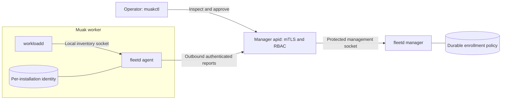

# Optional fleet inventory

**Status:** development feature in draft review. Booted fleet acceptance is pending.
See [ADR 0001](adr/0001-multi-host-coordination.md) for the decision, alternatives,
use cases and expert references.

Fleet inventory gives one manager a common view of explicitly approved Muak hosts
and their observed VMs. Agents initiate outbound mTLS gRPC connections. Each host
continues managing its own VMs while the manager is unavailable. This increment
provides inventory and enrollment; use existing single-host commands to change VMs.



## Deployment and wizard

Use a base image, fleetd extension and muakctl built from this feature together.
The base image must include the new apid routes, fleet permissions, workload
publisher and SELinux labels. An older base cannot acquire those capabilities by
adding the extension alone.

The [OCI recipe](../services/fleetd/Dockerfile) supplies an ordinary extension
filesystem containing `/sbin/fleetd` and `/etc/services/fleetd.service`. Wizard
resolves the selected extension and builds its EROFS payload through the existing
pipeline. The image also supplies the optional build metadata `/.muak/file_contexts`.
Wizard consumes these bounded SELinux labeling rules and omits the metadata file
from the payload. Existing extensions without this metadata keep their behavior.
The base installer does not include fleetd or its service descriptor.
There are no new external runtime binaries or separate database processes.

For a development registry, build the package with the existing recipe:

```sh
REGISTRY=localhost:5000 just oci fleetd
```

This command publishes to that development registry. Repack/sign and register
`pkgs/fleetd` under the extension name `fleetd` in the development catalog using
the project's existing catalog workflow. Pin its real digest; this draft does not
publish an official package or supply a release digest. Use the matching locally
built wizard/toolchain for extension labeling, including the wizard linked into
provisiond for installed-host updates.

Select `fleetd` alongside the required hypervisor extensions. For artifact builds,
append it to the existing profile's `[customization].extensions`; for installed
hosts, append it to `[host].extensions` in their full runtime configuration. Keep
the existing kernel, disk, network and hypervisor settings. Example selections:

```toml
# Wizard profile fragment
[customization]
extensions = ["qemu", "fleetd"]
```

```toml
# Runtime configuration fragment, within api_version = "muak.dev/config/v1-beta"
[host]
extensions = ["qemu", "fleetd"]
```

Omitting `[fleet]` leaves fleet management disabled. Installing the optional
extension without selecting a role starts no enrollment or reporting loop. Its
management methods return a role precondition error. Existing standalone profiles
and local workload management remain valid.

## Configure the manager

Choose one installed host as the manager. Obtain its current full configuration,
add the extension selection and manager role, then apply it through the usual
install/update path:

```sh
muakctl --context manager config get --output manager.toml
# Edit manager.toml; preserve the existing settings and append fleetd.
muakctl --context manager update --config manager.toml
```

```toml
[fleet]
role = "manager"
max_nodes = 256
stale_after_secs = 60
```

After the updated host boots, inspect its management domain using an existing
trusted administrator context:

```sh
muakctl --context manager fleet info
```

Record the domain UUID, expected TLS server name and public CA PEM. Transfer these
through a trusted configuration channel. The agent verifies this CA and server
identity from its first connection; it never learns trust from an unverified peer.

There is one configured coordinator in this increment. It is not elected, and
there is no automatic failover. Preserve its STATE and host PKI. Replacing a
manager or restoring an old backup requires an explicit authority-recovery plan;
an old backup can predate revocations. Never operate two managers from copies of
the same state as independent authorities.

## Configure and enroll a worker

Append `fleetd` to the worker's extensions and add this role to its full runtime
configuration, replacing the example endpoint, domain and CA with trusted values:

```toml
[fleet]
role = "agent"
manager = "https://manager.example.net:50051"
domain = "f0b96bb9-54ee-4a9f-abab-186e2178096a"
server_name = "muak-server"
report_interval_secs = 10
ca_pem = '''-----BEGIN CERTIFICATE-----
REPLACE_WITH_THE_MANAGER_CA
-----END CERTIFICATE-----'''
```

Apply this configuration using the normal install/update flow. Generate identity
on each installation: never distribute a node UUID, private key or populated
fleet STATE in a reusable image, wizard profile or kernel command line. Ordinary
updates retain the node's STATE. Cloning an installed STATE also clones its
identity and is not a supported way to add a worker.

The agent generates and durably stores its own key, CSR and node UUID. Consult its
local enrollment state through that worker's existing administrator context:

```sh
muakctl --context worker fleet agent-status
muakctl --context manager auth requests
muakctl --context manager auth approve FULL_CSR_FINGERPRINT --permissions fleet:report
```

Compare the full CSR public-key fingerprint through the trusted worker context
before approving it. The CSR fingerprint differs from the issued certificate's
fingerprint. Once the certificate is delivered, the agent presents it to request a
node binding. Review and approve that exact binding on the manager:

```sh
muakctl --context worker fleet agent-status
muakctl --context manager fleet nodes
muakctl --context manager fleet approve NODE_UUID FULL_CERTIFICATE_FINGERPRINT
```

Compare the node UUID and certificate fingerprint reported by the worker. Requests
remain pending until this explicit approval; a valid certificate alone cannot
claim an approved node's identity. Subsequent reconnects reuse the same node UUID
and replace the previous session without creating another registration.

## Consult the fleet

```sh
muakctl --context manager fleet nodes
muakctl --context manager fleet vms
muakctl --context worker fleet agent-status
muakctl --context manager logs --service fleetd
muakctl --context manager dmesg
```

`nodes` shows registration status, freshness, observation age and the certificate
binding. `vms` shows node-qualified VM UUIDs, names, lifecycle states and freshness.
Reported state comes from workloadd's actor; fleetd receives a minimal read-only
publication through a separate local socket. No manager connection reaches the
worker's VM command socket.

For display, an empty VM name falls back to its UUID and an overlong name is
shortened at a UTF-8 boundary with `...`. The local VM name, identity and state
are unchanged. Hostnames in the inventory follow the latest accepted observation.

Treat stale VM records as last observations. They are not evidence that a VM
stopped. A new session remains stale until a new complete snapshot is accepted.
If local publication stops, the agent stops reporting rather than fabricating an
empty inventory. If the manager restarts, observations are initially absent and
rebuild from fresh reports; approved registrations and revocations remain durable.

Agents retry after the configured interval plus up to two seconds of jitter.
The interval must leave time for three reports and jitter before the manager's
staleness threshold; incompatible settings produce an agent error. A manager
outage interrupts fleet consultation and reporting, while local VM operations
continue through their existing service path.

| Permission | Purpose |
| --- | --- |
| `fleet:read` | Read manager information and inventory. |
| `fleet:report` | Request a node binding and report for an approved session. |
| `fleet:manage` | Approve, revoke or replace bindings; inspect or renew a local agent credential. |

Permissions are independent; a reviewing operator needs read and manage access,
or the existing administrator role. Agents receive only `fleet:report`.
Management uses existing CLI contexts and endpoint selection.

## Rotate and revoke

Request key renewal through the worker's administrator context. The next agent
iteration persists a new key and CSR while preserving its node UUID:

```sh
muakctl --context worker fleet renew-agent-credential
muakctl --context worker fleet agent-status
muakctl --context manager auth approve NEW_CSR_FINGERPRINT --permissions fleet:report
muakctl --context worker fleet agent-status
muakctl --context manager fleet rotate-credential NODE_UUID NEW_CERTIFICATE_FINGERPRINT
muakctl --context manager auth revoke OLD_CERTIFICATE_FINGERPRINT
```

Wait for each enrollment phase before using the next fingerprint. New reports are
blocked until the manager's node binding changes. Rotation invalidates the old
reporting session. Revoke the old certificate in authentication state as well.
Renewal is operator-triggered; automatic renewal and manager CA rotation are not
implemented in this slice.

To remove a worker, revoke its node binding and its reporting certificate:

```sh
muakctl --context manager fleet revoke NODE_UUID
muakctl --context manager auth revoke FULL_CERTIFICATE_FINGERPRINT
```

The revoked registration remains visible and consumes a record slot. Reuse is an
explicit replacement/enrollment operation; revoked identities are not silently
approved again. Once revocation is durable, the manager discards that node's VM
observation and releases its inventory byte budget. Its registration, certificate
binding and revocation remain intact; reconnecting with the old credential still
fails. Other nodes keep their observations, including stale observations.
Administrative decisions are logged with the operator certificate
fingerprint, operation and node UUID. A bounded tail of 256 decisions is also
persisted with manager policy; this is not an external tamper-proof audit system.
Decisions use Muak's kernel logger and are available through `dmesg`; service
stdout/stderr and supervisor diagnostics remain available through `logs`.

## Storage, limits and recovery

Manager policy lives at `/run/state/fleet/manager.json`; the agent's own identity
and private key live at `/run/state/fleet/agent.json`. Files are created with mode
0600. Exclusive writer locks, file synchronization, atomic rename and directory
synchronization protect replacement. Invalid or unsupported state causes startup
to fail without resetting identity. A failed durable write disables further state
operations until restart and explicit recovery.

The manager accepts 1–1024 records, including pending and revoked registrations;
the default is 256. Each snapshot holds at most 1024 VMs, with names and hostname
bounded to 255 bytes. Aggregate accepted snapshot payloads are bounded to 2 MiB;
an over-budget report is rejected without erasing prior inventory. Persisted files
and incoming RPC messages are independently bounded to 1 MiB. These are initial
limits, not measured scale or availability guarantees.

Back up manager policy together with its host PKI through an operator-managed,
trusted process. This slice adds no backup/restore API. Do not delete or replace
fleet identity files merely to
make enrollment retry: endpoint trust, domain changes and authority replacement
require an explicit recovery procedure. Stale snapshots and revocation rollback
must be considered before restoring an old manager backup.

## Booted acceptance

The process-level suite uses real local mTLS and Muak PKI, apid's permission and
proxy primitives, temporary durable state and two agents. Its CSR service and VM
summaries are fixtures. It proves those adapters within the harness; it does not
prove boot, a live hypervisor, granola supervision or enforced SELinux behavior.

### Automated fleet scenario

`e2e/tests/fleet.rs` drives the real CLI against three installed Muak guests:
one manager and two workers, each installed from the same ISO with separate STATE
and operator credentials. It exercises production CSR and node approvals,
distinct identities, real workloadd observations, workload create/start/stop/delete,
worker reboot and forced update, manager reboot, key renewal and revocation.
The nested workload must emit a Linux boot banner through the real serial-log API;
application readiness inside that workload is outside this inventory test.
Revocation must remove the observed VMs without preventing local workload access
or interrupting the other worker's reporting. The test also requires an enforcing
SELinux boot marker on all three hosts.

Run it explicitly after preparing the matching development catalog:

```sh
MUAK_FLEET_VM_KERNEL=/absolute/path/to/workload-kernel \
MUAK_FLEET_VM_INITRD=/absolute/path/to/workload-initrd \
REGISTRY=10.0.2.2:5000 just e2e-fleet
```

Prerequisites:

- A matching ISO and catalog containing the rebuilt base, the `qemu` extension
  and the `fleetd` extension, including their selected kernel and module packages.
  Rebuild the toolchain first when testing the wizard changes. Enforcing SELinux
  must be enabled in the selected kernel command line.
- QEMU, OVMF, accessible KVM, at least 6 GiB available for the three 2 GiB hosts
  plus host and nested workload overhead, and sufficient sparse disk storage.
- Nested KVM available inside the workers. A real x86_64 kernel and initrd that
  keep a small guest alive with 256 MiB RAM and `console=ttyS0`; the test supplies
  no root filesystem or network setup to that workload. These are workload inputs,
  not synthetic boot fixtures.
- The test registry reachable from guests at `10.0.2.2:5000`. Workers reach the
  manager through `10.0.2.2` and its host-forwarded API port; each CLI has its own
  temporary operator configuration.

The fleet test is ignored by the ordinary `just e2e` invocation because the
default development catalog need not contain fleetd. `just e2e-fleet` explicitly
selects and runs it, with no successful skip for missing prerequisites. CLI polling
and lifecycle operations have deadlines, and timed-out CLI processes are killed.
Compilation and linting include the test even when it is not run.

**Execution status:** this scenario has not been run on a booted Muak here because
`/dev/kvm` is unavailable. Adding the scenario does not satisfy its acceptance gate.
It also does not inject WAN partitions, filesystem faults or forbidden socket
access; those remain separate qualification steps below.

### Qualification checklist

Before promoting this draft:

1. Build matching base and fleet extension artifacts, publish them to a local test
   catalog and inspect wizard's selected and standalone outputs.
2. Run `just e2e` for the existing standalone scenarios and `just e2e-fleet` on a
   KVM-capable host. Record the exact commit, artifact digests and results.
3. Complete both approvals using the CLI. Create/start/stop a VM through its usual
   worker context; verify the manager inventory reflects actual workload changes.
4. Disconnect a worker, observe stale CLI output, reconnect, then reboot and update
   it. Verify one registration and preserved identity throughout.
5. Restart the manager; verify preserved approvals/revocations, initially absent
   observations and reconstruction only from new authenticated reports.
6. Exercise credential renewal and revocation. Check socket denials under enforcing
   SELinux, including attempts to command workloadd from fleetd and approve a node
   through the inventory publisher.
7. Verify a standalone installation still boots and manages VMs with no fleet role
   or coordinator dependency. Qualify recovery and storage-failure behavior before
   relying on this feature operationally.
